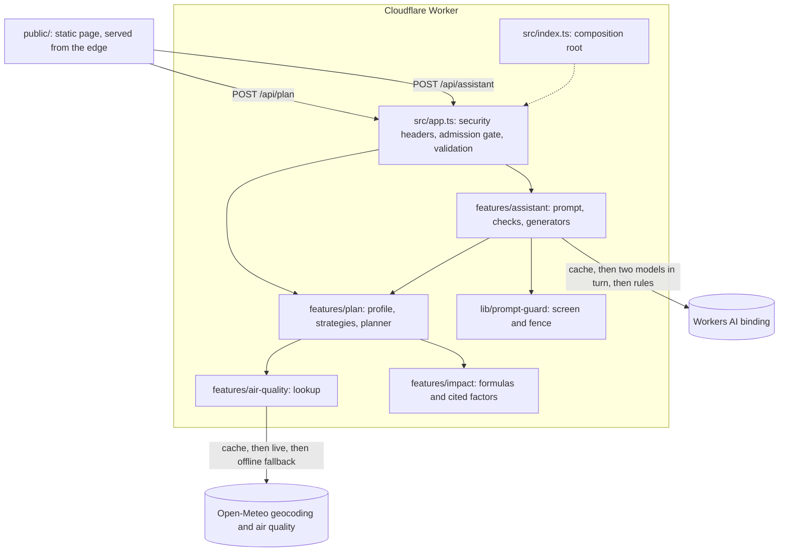

# Saaf Saans

**Saaf Saans** ("clean breath") is a GenAI-powered assistant that helps families
and communities live through severe winter smog. You tell it where you live and
how you live; it reads the live air for your city, builds a plan of low-emission
daily routines, indoor air quality hacks and sustainable alternatives, and shows
the direct impact of every choice, worked out by fixed formulas from cited
factors. Generative AI explains the plan; the figures come from the engine.

Live: <https://saaf-saans.seriouss.workers.dev>

## Chosen Vertical

**Challenge 6: Urban Air Quality Assistant.**

> Create a GenAI-powered assistant that helps families and communities navigate
> severe winter smog and urban air pollution. The application should suggest
> low-emission daily routines, indoor air quality hacks, and sustainable
> alternatives tailored to their location and lifestyle, while clearly
> explaining the direct impact of their choices.

## Challenge Alignment

| Ref | Brief phrase                                          | What the app does                                                                                                                                                                                                            | Where in the UI                                                                 | Code                                                                                                                                                                                                                                                                                                         | Tests                                                                                                                   |
| --- | ----------------------------------------------------- | ---------------------------------------------------------------------------------------------------------------------------------------------------------------------------------------------------------------------------- | ------------------------------------------------------------------------------- | ------------------------------------------------------------------------------------------------------------------------------------------------------------------------------------------------------------------------------------------------------------------------------------------------------------ | ----------------------------------------------------------------------------------------------------------------------- |
| C1  | GenAI-powered assistant                               | Workers AI words the computed plan for this household or group as schema-validated JSON; a second model is asked if the first fails or is rejected, and rules write the text if both do                                      | "Your GenAI-powered assistant says", and an "AI explanation" on each card       | [features/assistant/](src/features/assistant/)                                                                                                                                                                                                                                                               | [test/features/assistant/](test/features/assistant/)                                                                    |
| C2  | families and communities                              | Two modes with their own fields: a household, or an RWA, school or neighbourhood group of 5 to 50,000 people                                                                                                                 | "Families and communities: who is this plan for?"                               | [plan/schemas.ts](src/features/plan/schemas.ts), [plan/situation.ts](src/features/plan/situation.ts)                                                                                                                                                                                                         | [situation.test.ts](test/features/plan/situation.test.ts), [form-modes.dom.test.ts](test/public/form-modes.dom.test.ts) |
| C3  | severe winter smog and urban air pollution            | Live US AQI, PM2.5, PM10, dominant pollutant and the cleanest and worst hours of the next 24, with health advice per AQI band                                                                                                | "Severe winter smog and urban air pollution: your air now"                      | [features/air-quality/](src/features/air-quality/)                                                                                                                                                                                                                                                           | [test/features/air-quality/](test/features/air-quality/)                                                                |
| C4  | low-emission daily routines                           | Re-times outdoor activity and airing to the cleanest hour, moves it indoors on the worst days, masks open-air commutes                                                                                                       | "Low-emission daily routines"                                                   | [shift-outdoor-time.ts](src/features/plan/strategies/shift-outdoor-time.ts), [exercise-indoors.ts](src/features/plan/strategies/exercise-indoors.ts), [mask-on-commute.ts](src/features/plan/strategies/mask-on-commute.ts), [air-at-cleanest-hour.ts](src/features/plan/strategies/air-at-cleanest-hour.ts) | [test/features/plan/strategies/](test/features/plan/strategies/)                                                        |
| C5  | indoor air quality hacks                              | A clean-air room with a purifier or a DIY box-fan filter, windows shut through the peak, sealed gaps                                                                                                                         | "Indoor air quality hacks"                                                      | [clean-air-room.ts](src/features/plan/strategies/clean-air-room.ts), [close-at-peak.ts](src/features/plan/strategies/close-at-peak.ts), [seal-gaps.ts](src/features/plan/strategies/seal-gaps.ts)                                                                                                            | [test/features/plan/strategies/](test/features/plan/strategies/)                                                        |
| C6  | sustainable alternatives                              | Metro instead of a driven commute, credit for a commute that is already clean, LPG or induction instead of solid fuel, composting instead of open burning                                                                    | "Sustainable alternatives"                                                      | [switch-commute.ts](src/features/plan/strategies/switch-commute.ts), [keep-commute.ts](src/features/plan/strategies/keep-commute.ts), [clean-cooking.ts](src/features/plan/strategies/clean-cooking.ts), [stop-waste-burning.ts](src/features/plan/strategies/stop-waste-burning.ts)                         | [test/features/plan/strategies/](test/features/plan/strategies/)                                                        |
| C7  | tailored to their location                            | Geocodes the place typed, then reads air quality for those coordinates from Open-Meteo, server-side, with a timeout, an edge cache and an offline fallback that is labelled as such                                          | "Tailored to your location"                                                     | [air-quality/service.ts](src/features/air-quality/service.ts), [providers/](src/features/air-quality/providers/)                                                                                                                                                                                             | [providers/](test/features/air-quality/providers/)                                                                      |
| C8  | tailored to their lifestyle                           | The profile (who is in the family, commute, cooking fuel, home type, purifier, outdoor habits; or group type and size) decides which strategies apply and every figure in them                                               | "Tailored to your lifestyle" (three fieldsets)                                  | [plan/schemas.ts](src/features/plan/schemas.ts), [plan/planner.ts](src/features/plan/planner.ts)                                                                                                                                                                                                             | [schemas.test.ts](test/features/plan/schemas.test.ts), [planner.test.ts](test/features/plan/planner.test.ts)            |
| C9  | clearly explaining the direct impact of their choices | Every recommendation carries PM2.5 not breathed in (µg a day), PM2.5 not emitted (g a week) or CO2e saved (kg a week), the arithmetic written out, and each factor marked "Published figure" or "Assumption" with its source | "The direct impact of your choices", and "How this was calculated" on each card | [features/impact/](src/features/impact/), [impact/factors/](src/features/impact/factors/)                                                                                                                                                                                                                    | [test/features/impact/](test/features/impact/)                                                                          |

[PROBLEM_ALIGNMENT.md](PROBLEM_ALIGNMENT.md) traces each clause in more detail.

## Capabilities

- **Live air for any city.** US AQI, PM2.5, PM10 and the dominant pollutant,
  with the AQI band given as a number, a category in words and a symbol, never
  by colour alone.
- **The next 24 hours.** The cleanest and the worst hour, and an hour-by-hour
  PM2.5 table.
- **A plan that fits.** Eleven strategies in three groups; each applies only
  when the profile and the air call for it, and a choice that is already clean
  is credited rather than lectured.
- **Numbers you can check.** Three impact figures per recommendation and in
  total, the formula with its inputs, and every factor labelled as a published
  figure or an assumption.
- **An assistant held to the computed facts.** A model reply containing a
  numeral that is not in the computed facts (or the visitor's own notes) is
  rejected, so the model cannot introduce a figure of its own.
- **Degrades instead of failing.** If the air data API is unreachable the app
  plans from typical winter values and says so (place search then knows ten
  built-in Indian cities only); if neither model answers in time the same
  explanation is written by rules and labelled as such.
- **Accessible and light.** WCAG 2.2 AA, light and dark themes, no framework,
  about 20 KB of HTML, CSS and JavaScript once gzipped.

## Approach and Logic

One decision carries the project: **the model explains, the engine computes.** A
language model is good at fitting advice to a family and bad at arithmetic, so
the two jobs are separated in code, not just in a prompt.

1. A deterministic **impact engine** ([features/impact/](src/features/impact/))
   turns air readings and a lifestyle profile into figures, using pure functions
   and a table of factors that are each either printed in a named source or
   labelled as an assumption.
2. A registry of **strategies**
   ([features/plan/strategies/](src/features/plan/strategies/)) decides which
   advice applies and writes out its arithmetic.
3. The **assistant** ([features/assistant/](src/features/assistant/)) receives
   the finished plan as facts and returns wording only. A number firewall
   ([number-firewall.ts](src/features/assistant/number-firewall.ts)) rejects any
   reply with a numeral the facts did not contain.

The code is organised so each of these can change without touching the others:

| Principle             | Where it shows                                                                                                                                                                                                                                                |
| --------------------- | ------------------------------------------------------------------------------------------------------------------------------------------------------------------------------------------------------------------------------------------------------------- |
| Single responsibility | 101 source modules, one job each (median 1.3 KB); one file per strategy, per factor family, per screening rule                                                                                                                                                |
| Open/closed           | [strategies/registry.ts](src/features/plan/strategies/registry.ts): a new strategy is a new file and one entry; the planner, the API and the page do not change                                                                                               |
| Liskov substitution   | Every provider and generator is checked against one contract in [providers/substitutable.test.ts](test/features/air-quality/providers/substitutable.test.ts) and [generators/substitutable.test.ts](test/features/assistant/generators/substitutable.test.ts) |
| Interface segregation | Narrow ports ([lib/ports.ts](src/lib/ports.ts), feature `types.ts`); routes receive only the sources and the gate they use                                                                                                                                    |
| Dependency inversion  | [src/index.ts](src/index.ts) is the only module that names a binding, `caches` or `fetch`; everything else takes ports as arguments                                                                                                                           |

[CODE_QUALITY.md](CODE_QUALITY.md) lists the files behind each row and the
limits that are enforced by lint and by tests.

## How the Solution Works

1. The visitor fills in one form and presses "Get my clean-air plan".
2. `POST /api/plan` validates the profile, resolves the place, reads its air
   (cache, then Open-Meteo, then the offline fallback) and runs every strategy.
   The page renders the air, the totals and the recommendations at once.
3. `POST /api/assistant` rebuilds the same plan server-side, screens and fences
   the visitor's notes, asks a Workers AI model to explain it, checks the reply
   (a second model is asked if the first fails or is rejected) and returns the
   wording. The page adds it to the cards already on screen.

Nobody waits on a model to see their air or their numbers, and a model outage
degrades one paragraph rather than the page.

## Directory Organization

```text
src/
  index.ts            composition root: picks an adapter for every port
  app.ts              assembles middleware and feature routes
  config/             options, limits, labels (shared with the page), runtime, env, security policy
  lib/                ports, cache, remember, content-key, clock, logger, timeout, fetch-json, app-error
    prompt-guard/     injection screen: scan, strip, fence, invisible, rules/ (one file per rule)
  middleware/         security-headers, admission, admission-rules, rate-limit, validate, error-handler
  features/
    air-quality/      types, schemas, service, view, aqi, aqi-bands, forecast
      providers/      open-meteo-*, typical-*, cached, fallback
    impact/           types, service (formulas), sentence
      factors/        one file per factor family
    plan/             routes, service, schemas, types, situation, planner, view
      strategies/     the contract, the registry, one file per strategy
    assistant/        routes, service, attempt, schemas, types, prompt, facts, prompt-builder,
                      reply-parser, reply-checks, reply-issues, number-firewall, workers-ai
      generators/     rules, fallback, cached
public/
  index.html          the page
  css/                tokens, base, form, results
  js/                 eleven ES modules, one responsibility each
test/                 mirrors src/ and public/js/, plus a11y/, conventions/ and support/
scripts/              build-assets.mjs: compiles src/config for the page, writes public/_headers
docs/decisions.md     short decision records
docs/build-log.md     the tools and prompts used to build this, and how they changed
```



## Endpoints

| Method and path       | Purpose                                                       | Body                                 | Reply                                                                     |
| --------------------- | ------------------------------------------------------------- | ------------------------------------ | ------------------------------------------------------------------------- |
| `POST /api/plan`      | Place, live air and the deterministic plan. No model involved | A family or community profile (JSON) | `place`, `air`, `advisory`, `recommendations`, `totals`, `findings`       |
| `POST /api/assistant` | The generative step: the same plan, explained                 | The same profile                     | `source` (`model` or `rules`), `summary`, `explanations`, `encouragement` |
| `GET /api/health`     | Liveness, and the public request limits                       | none                                 | `status`, `service`, `limits`                                             |
| `GET /*`              | The static page and its assets                                | none                                 | served from the edge without invoking the Worker                          |

Refusals share one shape, `{ error, code, issues: [{ field, message }] }`, with
status 400, 403, 404, 413, 415 or 429.

## Engineering Environment

| Concern       | Choice                                                                                                                                                |
| ------------- | ----------------------------------------------------------------------------------------------------------------------------------------------------- |
| Runtime       | Cloudflare Workers (`compatibility_date` 2026-08-22), static assets from `public/`                                                                    |
| Language      | TypeScript 5.9, strict, `noUncheckedIndexedAccess`; front end in plain ES modules type-checked through JSDoc                                          |
| HTTP          | Hono 4.13                                                                                                                                             |
| Validation    | zod 4.6 at every trust boundary                                                                                                                       |
| GenAI         | Workers AI binding: `@cf/mistralai/mistral-small-3.1-24b-instruct`, then `@cf/meta/llama-3.3-70b-instruct-fp8-fast` if the first fails or is rejected |
| Data          | Open-Meteo Air Quality and Geocoding APIs (free, no key)                                                                                              |
| Tests         | Vitest 4.1 in workerd (`@cloudflare/vitest-pool-workers`) and jsdom, axe-core 4.13, Istanbul coverage                                                 |
| Quality gates | ESLint 10 with typescript-eslint strict type-checked rules, Prettier 3, GitHub Actions                                                                |
| Node          | 22 or later; developed and verified on 26.5.0                                                                                                         |

There are no API keys and no secrets: inference is a binding, and the air data
API is keyless.

## Quick Start

```bash
npm ci
npm run check     # generate, typecheck, lint, format check, tests with the coverage gate
npm audit         # exits 0
npm run dev       # wrangler dev at http://localhost:8787
npm run deploy    # wrangler deploy
```

The Workers AI binding calls Cloudflare even in local development, so the model
path needs `wrangler login`.

## Testing Verification

`npm run check` on the committed tree:

```text
 Test Files  89 passed (89)
      Tests  415 passed (415)

Statements   : 100% ( 901/901 )
Branches     : 100% ( 308/308 )
Functions    : 100% ( 274/274 )
Lines        : 100% ( 794/794 )
```

| Measured over             | Statements | Branches | Functions | Lines |
| ------------------------- | ---------- | -------- | --------- | ----- |
| All files                 | 100        | 100      | 100       | 100   |
| `src/` (101 modules)      | 100        | 100      | 100       | 100   |
| `public/js/` (11 modules) | 100        | 100      | 100       | 100   |

Coverage is gated at 100% on all four measures in
[vitest.config.ts](vitest.config.ts), so the command fails below that. The suite
is hermetic: no test touches the network or needs a credential.
[TESTING.md](TESTING.md) describes the layers (unit, integration, accessibility,
security, conventions) and what was measured outside the suite, on Cloudflare
and by hand.

## Security Practices

| Measure                                                                                                                                                       | Where                                                                                                                                                                                                                |
| ------------------------------------------------------------------------------------------------------------------------------------------------------------- | -------------------------------------------------------------------------------------------------------------------------------------------------------------------------------------------------------------------- |
| JSON-only POST (the CSRF control), `Sec-Fetch-Site` and `Origin` checks, a 4 KB cap on the declared and on the actual body, 30 requests a minute per address  | [middleware/admission-rules.ts](src/middleware/admission-rules.ts), [middleware/validate.ts](src/middleware/validate.ts), [middleware/rate-limit.ts](src/middleware/rate-limit.ts), [wrangler.jsonc](wrangler.jsonc) |
| Strict schema on every request: unknown keys rejected, numbers bounded, text trimmed and capped                                                               | [plan/schemas.ts](src/features/plan/schemas.ts), [middleware/validate.ts](src/middleware/validate.ts)                                                                                                                |
| Prompt-injection screen: seven rules, flagged sentences removed, the rest fenced under a per-request random delimiter                                         | [lib/prompt-guard/](src/lib/prompt-guard/)                                                                                                                                                                           |
| Model output is untrusted: schema, id, number, finished-sentence and dropped-word checks before anything is shown                                             | [assistant/reply-checks.ts](src/features/assistant/reply-checks.ts), [assistant/reply-issues.ts](src/features/assistant/reply-issues.ts)                                                                             |
| Content Security Policy with `script-src 'self'`, no inline code, Trusted Types required; HSTS, `nosniff`, frame denial, COOP, CORP, COEP, 22 features denied | [config/security-policy.ts](src/config/security-policy.ts)                                                                                                                                                           |
| The page writes text, never markup                                                                                                                            | [public/js/dom.js](public/js/dom.js)                                                                                                                                                                                 |
| Upstream replies and cached values parsed against schemas                                                                                                     | [providers/open-meteo-schemas.ts](src/features/air-quality/providers/open-meteo-schemas.ts), [lib/remember.ts](src/lib/remember.ts)                                                                                  |
| No secrets, no storage of profiles, API replies `no-store`, cache keys hashed                                                                                 | [src/index.ts](src/index.ts), [lib/content-key.ts](src/lib/content-key.ts)                                                                                                                                           |
| `npm audit` clean, actions pinned to commit SHAs, CodeQL, dependency review, Dependabot                                                                       | [.github/](.github/)                                                                                                                                                                                                 |

[SECURITY.md](SECURITY.md) has the threat model and the reasoning.

## Optimization

- **The edge serves the page.** Static assets never invoke the Worker
  (`run_worker_first` is scoped to `/api/*`).
- **Split by cost.** The fast deterministic route answers first; the model route
  fills in afterwards.
- **Three caches** in the Workers Cache API: places for a day, air reports for
  ten minutes, narratives for ten minutes keyed by a hash of the brief.
- **Bounded waits.** Four seconds for an upstream call and fifteen for a model
  call, each cancelled through an abort signal, each with a fallback.
- **Short replies.** Output length is what a model call costs, so the model is
  asked for one sentence per recommendation inside a 600-token budget. Measured
  on Cloudflare (six profiles, 20 Nov 2026, with curl from India):
  `POST /api/assistant` answered in 8.2 to 11.4 s, every reply written by the
  first model on its first attempt, and `POST /api/plan` in 0.8 to 0.9 s.
- **Checked in a browser.** Lighthouse 13.6.0 on the live page (Chrome 158, 20
  Nov 2026) gives 100 for performance, accessibility, best practices and SEO on
  desktop; on mobile it gives 100 for the last three, and 97, 100 and 100 for
  performance over three runs.
- **Small payloads.** The page is 53.4 KB uncompressed and 19.8 KB gzipped for
  all twenty files; no framework and no third-party request.
- **Small bundle.** Importing zod as a namespace lets the bundler drop unused
  locales: 166 KB minified (54 KB gzipped) when bundled with esbuild, down from
  515 KB.

[EFFICIENCY.md](EFFICIENCY.md) has the measurements.

## Accessibility Compliance

Built to WCAG 2.2 level AA and checked by tests on every run: axe-core over the
rendered page in five states and both themes, computed contrast for every colour
pair, and structural checks.

| Success criterion           | How it is met                                                                                                                       |
| --------------------------- | ----------------------------------------------------------------------------------------------------------------------------------- |
| 1.3.1, 3.3.2                | Landmarks, one `h1`, a label for every control, five fieldsets with legends                                                         |
| 1.4.1                       | The AQI band is a number, a category in words and a symbol; invalid fields get a thicker border and a message                       |
| 1.4.3, 1.4.11               | Text at 4.5:1 or better and boundaries at 3:1 or better, in light and dark themes                                                   |
| 1.4.4, 1.4.10               | Sizes in `rem`, no fixed widths, zoom never disabled                                                                                |
| 2.1.1, 2.4.1, 2.4.7, 2.4.11 | Native controls only, a skip link, a 3px focus ring that is never removed                                                           |
| 2.4.1, 2.4.3, 2.4.4         | A navigation named "Sections of your plan" opens the results with a link to each part; following a link moves focus to that heading |
| 2.4.6, 2.5.3, 4.1.2         | Each "How this was calculated" disclosure is named after its card, beginning with the words on screen                               |
| 2.5.8                       | Every control's target is at least 48px high                                                                                        |
| 3.3.1, 3.3.3                | An error summary that takes focus and links to each field, with the message beside the field                                        |
| 4.1.2, 4.1.3                | Results announced through a polite live region, errors through an alert                                                             |

`prefers-reduced-motion` and `forced-colors` are honoured. The submit button
uses `aria-disabled` while a request is in flight, so it stays focusable.
[ACCESSIBILITY.md](ACCESSIBILITY.md) lists each criterion with its test.

## How GenAI Is Used

- **Models.** Two, asked in order through the Workers AI binding
  ([config/runtime.ts](src/config/runtime.ts)):
  `@cf/mistralai/mistral-small-3.1-24b-instruct` writes the text, and
  `@cf/meta/llama-3.3-70b-instruct-fp8-fast` is asked only when the first call
  fails, times out or returns a reply that is rejected
  ([service.ts](src/features/assistant/service.ts),
  [attempt.ts](src/features/assistant/attempt.ts)). Every request carries a JSON
  Schema generated from the same zod schema that validates the reply
  ([assistant/schemas.ts](src/features/assistant/schemas.ts)). Record 10 in
  [docs/decisions.md](docs/decisions.md) has the measurements behind the choice.
- **Prompt design.** A fixed system prompt
  ([prompt.ts](src/features/assistant/prompt.ts)) and a user message of computed
  facts ([facts.ts](src/features/assistant/facts.ts)): the air, the outlook, the
  health advice, the profile, and each recommendation with its impact. The model
  is asked for a two-sentence summary, one sentence of advice per recommendation
  giving the reason it matters for these people, and a closing line. The limits
  (30, 50 and 15 words) are stated in the prompt, and the model is told not to
  repeat an action or its impact, which the page prints beside its sentence.
- **Guardrails.** Notes and the geocoder's place name are screened and fenced;
  the reply must be one complete JSON object that matches the schema, explains
  every recommendation exactly once, contains no numeral outside the facts and
  the visitor's own notes, finishes every sentence and has no gap where a word
  was dropped ([reply-checks.ts](src/features/assistant/reply-checks.ts),
  [reply-issues.ts](src/features/assistant/reply-issues.ts)). When a reply is
  rejected, the second model receives the same request with the reasons.
- **Fallback.** When both attempts fail, a rule-based generator writes the same
  structure ([generators/rules.ts](src/features/assistant/generators/rules.ts)),
  and the page says which of the two wrote the text. Each attempt is logged with
  the model's name and its outcome.
- **Building it.** Generative AI also built the project. The tools, the prompts
  that mattered, how they changed and who did what are in
  [docs/build-log.md](docs/build-log.md).

## Assumptions Made

- **US AQI.** The index and the dominant pollutant come from Open-Meteo's US AQI
  fields, and the advice follows the AirNow categories. India's national index
  is not computed.
- **Modelled, not measured, exposure.** Doses use population-average breathing
  rates and assumed infiltration, room sizes and hours. Each assumption is
  labelled as one in the interface and listed in
  [features/impact/factors/](src/features/impact/factors/).
- **Emission factors from the UK.** Travel factors are the UK government's 2024
  conversion factors, used for want of an equally citable Indian table.
- **Typical values are illustrative.** The offline fallback uses round winter
  figures for ten Indian cities, marked as typical wherever they appear. While
  the geocoder is unreachable, only those ten cities can be found.
- **A group changes partly.** Community travel figures assume 30% of the group
  takes part.
- **General guidance only.** The assistant does not diagnose or prescribe.

## Licence

MIT. See [LICENSE](LICENSE).
